# IELTStudy data model (ERD)

Source of truth: `backend/src/prisma/schema.prisma`. Baseline migration: `backend/migrations/app/20261023T1815_init/`. This page explains the model and lists the rules the database cannot enforce on its own. Reviewed at the Phase 1 Gate; after that, schema changes need approval (see `CLAUDE.md`).

## Diagram (Chen notation)

How to read it:

| Shape | Meaning |
| --- | --- |
| Rectangle | **Entity**: a thing we store (one table) |
| Diamond | **Relationship** between two entities |
| Oval | **Attribute**: a column. The <u>underlined</u> one is the entity's key |
| `1`, `N`, `M` on a line | **Cardinality**: `1–N` is one-to-many, `M–N` is many-to-many |

Marks on attributes:
- `FK` means a foreign key, which is how a 1–N relationship is stored.
- `unique` means no two rows can share the value.
- `JSONB` means a JSON column (shapes under *JSONB shapes*).

Every M–N relationship is stored as its own join table, named in its diamond (for example `question_skills`). The ovals on that diamond are the join table's extra columns, and its key is the pair of foreign keys.

Use the preview's zoom, or open it full screen, because the diagram is large.

```mermaid
flowchart TB
    %% Entities
    User["User"]
    Course["Course"]
    Lesson["Lesson"]
    Passage["Passage / Media"]
    Skill["Skill"]
    Question["Question"]
    Quiz["Quiz"]
    Attempt["Quiz Attempt"]
    Response["Question Response"]
    Rec["Recommendation"]

    %% Relationships, with cardinality on each side
    teaches{"teaches"}
    User ---|1| teaches ---|N| Course
    reviews{"reviews"}
    User ---|1| reviews ---|N| Course
    contains{"contains"}
    Course ---|1| contains ---|N| Lesson
    holds{"holds"}
    Lesson ---|1| holds ---|N| Passage
    isAbout{"is about"}
    Passage ---|1| isAbout ---|N| Question
    hasQuiz{"has quiz"}
    Lesson ---|1| hasQuiz ---|N| Quiz
    includes{"includes<br/>(quiz_questions)"}
    Quiz ---|M| includes ---|N| Question
    measures{"measures<br/>(question_skills)"}
    Question ---|M| measures ---|N| Skill
    taggedWith{"tagged with<br/>(lesson_skills)"}
    Lesson ---|M| taggedWith ---|N| Skill
    createsPassage{"creates"}
    User ---|1| createsPassage ---|N| Passage
    createsQuestion{"creates"}
    User ---|1| createsQuestion ---|N| Question
    createsQuiz{"creates"}
    User ---|1| createsQuiz ---|N| Quiz
    enrolsIn{"enrols in<br/>(enrollments)"}
    User ---|M| enrolsIn ---|N| Course
    studies{"studies<br/>(lesson_progress)"}
    User ---|M| studies ---|N| Lesson
    takes{"takes"}
    User ---|1| takes ---|N| Attempt
    attemptOf{"is an attempt of"}
    Quiz ---|1| attemptOf ---|N| Attempt
    records{"records"}
    Attempt ---|1| records ---|N| Response
    answers{"answers"}
    Question ---|1| answers ---|N| Response
    masters{"has mastery of<br/>(user_skill_mastery)"}
    User ---|M| masters ---|N| Skill
    receives{"receives"}
    User ---|1| receives ---|N| Rec
    forSkill{"is for weak skill"}
    Skill ---|1| forSkill ---|N| Rec
    suggestsLesson{"suggests"}
    Lesson ---|1| suggestsLesson ---|N| Rec
    suggestsQuiz{"suggests"}
    Quiz ---|1| suggestsQuiz ---|N| Rec
    triggers{"triggers"}
    Attempt ---|1| triggers ---|N| Rec

    %% Entity attributes (the underlined one is the key)
    User --- User_user_id(["<u>user_id</u>"])
    User --- User_email(["email (unique)"])
    User --- User_full_name(["full_name"])
    User --- User_hashed_pass(["hashed_pass"])
    User --- User_role(["role"])
    User --- User_target_band(["target_band"])
    User --- User_is_active(["is_active"])
    User --- User_created_at(["created_at"])
    User --- User_updated_at(["updated_at"])
    Course --- Course_course_id(["<u>course_id</u>"])
    Course --- Course_instructor_id(["instructor_id (FK)"])
    Course --- Course_title(["title"])
    Course --- Course_description(["description"])
    Course --- Course_target_level(["target_level"])
    Course --- Course_status(["status"])
    Course --- Course_review_feedback(["review_feedback"])
    Course --- Course_reviewed_by_id(["reviewed_by_id (FK)"])
    Course --- Course_submitted_at(["submitted_at"])
    Course --- Course_reviewed_at(["reviewed_at"])
    Course --- Course_created_at(["created_at"])
    Course --- Course_updated_at(["updated_at"])
    Lesson --- Lesson_lesson_id(["<u>lesson_id</u>"])
    Lesson --- Lesson_course_id(["course_id (FK)"])
    Lesson --- Lesson_title(["title"])
    Lesson --- Lesson_content(["content"])
    Lesson --- Lesson_kind(["kind"])
    Lesson --- Lesson_order_index(["order_index"])
    Lesson --- Lesson_created_at(["created_at"])
    Lesson --- Lesson_updated_at(["updated_at"])
    Passage --- Passage_passage_id(["<u>passage_id</u>"])
    Passage --- Passage_lesson_id(["lesson_id (FK)"])
    Passage --- Passage_created_by_id(["created_by_id (FK)"])
    Passage --- Passage_type(["type"])
    Passage --- Passage_title(["title"])
    Passage --- Passage_content(["content"])
    Passage --- Passage_media_path(["media_path"])
    Passage --- Passage_order_index(["order_index"])
    Passage --- Passage_created_at(["created_at"])
    Passage --- Passage_updated_at(["updated_at"])
    Skill --- Skill_skill_id(["<u>skill_id</u>"])
    Skill --- Skill_skill_code(["skill_code (unique)"])
    Skill --- Skill_name(["name"])
    Skill --- Skill_category(["category"])
    Skill --- Skill_description(["description"])
    Skill --- Skill_created_at(["created_at"])
    Question --- Question_question_id(["<u>question_id</u>"])
    Question --- Question_passage_id(["passage_id (FK)"])
    Question --- Question_created_by_id(["created_by_id (FK)"])
    Question --- Question_question_type(["question_type"])
    Question --- Question_question_text(["question_text"])
    Question --- Question_options(["options (JSONB)"])
    Question --- Question_answer_key(["answer_key (JSONB)"])
    Question --- Question_explanation(["explanation"])
    Question --- Question_difficulty(["difficulty"])
    Question --- Question_created_at(["created_at"])
    Question --- Question_updated_at(["updated_at"])
    Quiz --- Quiz_quiz_id(["<u>quiz_id</u>"])
    Quiz --- Quiz_kind(["kind"])
    Quiz --- Quiz_lesson_id(["lesson_id (FK)"])
    Quiz --- Quiz_created_by_id(["created_by_id (FK)"])
    Quiz --- Quiz_title(["title"])
    Quiz --- Quiz_description(["description"])
    Quiz --- Quiz_time_limit_seconds(["time_limit_seconds"])
    Quiz --- Quiz_created_at(["created_at"])
    Quiz --- Quiz_updated_at(["updated_at"])
    Attempt --- Attempt_attempt_id(["<u>attempt_id</u>"])
    Attempt --- Attempt_user_id(["user_id (FK)"])
    Attempt --- Attempt_quiz_id(["quiz_id (FK)"])
    Attempt --- Attempt_started_at(["started_at"])
    Attempt --- Attempt_completed_at(["completed_at"])
    Attempt --- Attempt_total_score(["total_score"])
    Attempt --- Attempt_max_score(["max_score"])
    Attempt --- Attempt_mastery_changes(["mastery_changes (JSONB)"])
    Response --- Response_response_id(["<u>response_id</u>"])
    Response --- Response_attempt_id(["attempt_id (FK)"])
    Response --- Response_question_id(["question_id (FK)"])
    Response --- Response_user_answer(["user_answer (JSONB)"])
    Response --- Response_is_correct(["is_correct"])
    Response --- Response_attempt_order(["attempt_order"])
    Response --- Response_response_time_seconds(["response_time_seconds"])
    Response --- Response_answered_at(["answered_at"])
    Rec --- Rec_recommendation_id(["<u>recommendation_id</u>"])
    Rec --- Rec_user_id(["user_id (FK)"])
    Rec --- Rec_skill_id(["skill_id (FK)"])
    Rec --- Rec_lesson_id(["lesson_id (FK)"])
    Rec --- Rec_quiz_id(["quiz_id (FK)"])
    Rec --- Rec_source_attempt_id(["source_attempt_id (FK)"])
    Rec --- Rec_mastery_prob(["mastery_prob"])
    Rec --- Rec_rank(["rank"])
    Rec --- Rec_score(["score"])
    Rec --- Rec_rationale(["rationale"])
    Rec --- Rec_created_at(["created_at"])
    Rec --- Rec_clicked_at(["clicked_at"])

    %% Relationship attributes (extra columns of the join tables)
    includes --- includes_order_index(["order_index"])
    measures --- measures_weight(["weight"])
    taggedWith --- taggedWith_weight(["weight"])
    enrolsIn --- enrolsIn_enrolled_at(["enrolled_at"])
    enrolsIn --- enrolsIn_completed_at(["completed_at"])
    studies --- studies_status(["status"])
    studies --- studies_started_at(["started_at"])
    studies --- studies_completed_at(["completed_at"])
    studies --- studies_updated_at(["updated_at"])
    masters --- masters_mastery_prob(["mastery_prob"])
    masters --- masters_observations(["observations"])
    masters --- masters_updated_at(["updated_at"])

    classDef entity fill:#dbeafe,stroke:#1e40af,color:#000
    classDef relationship fill:#fef3c7,stroke:#b45309,color:#000
    classDef attribute fill:#f3f4f6,stroke:#6b7280,color:#000
    class User,Course,Lesson,Passage,Skill,Question,Quiz,Attempt,Response,Rec entity
    class teaches,reviews,contains,holds,isAbout,hasQuiz,includes,measures,taggedWith,createsPassage,createsQuestion,createsQuiz,enrolsIn,studies,takes,attemptOf,records,answers,masters,receives,forSkill,suggestsLesson,suggestsQuiz,triggers relationship
    class User_user_id,User_email,User_full_name,User_hashed_pass,User_role,User_target_band,User_is_active,User_created_at,User_updated_at,Course_course_id,Course_instructor_id,Course_title,Course_description,Course_target_level,Course_status,Course_review_feedback,Course_reviewed_by_id,Course_submitted_at,Course_reviewed_at,Course_created_at,Course_updated_at,Lesson_lesson_id,Lesson_course_id,Lesson_title,Lesson_content,Lesson_kind,Lesson_order_index,Lesson_created_at,Lesson_updated_at,Passage_passage_id,Passage_lesson_id,Passage_created_by_id,Passage_type,Passage_title,Passage_content,Passage_media_path,Passage_order_index,Passage_created_at,Passage_updated_at,Skill_skill_id,Skill_skill_code,Skill_name,Skill_category,Skill_description,Skill_created_at,Question_question_id,Question_passage_id,Question_created_by_id,Question_question_type,Question_question_text,Question_options,Question_answer_key,Question_explanation,Question_difficulty,Question_created_at,Question_updated_at,Quiz_quiz_id,Quiz_kind,Quiz_lesson_id,Quiz_created_by_id,Quiz_title,Quiz_description,Quiz_time_limit_seconds,Quiz_created_at,Quiz_updated_at,Attempt_attempt_id,Attempt_user_id,Attempt_quiz_id,Attempt_started_at,Attempt_completed_at,Attempt_total_score,Attempt_max_score,Attempt_mastery_changes,Response_response_id,Response_attempt_id,Response_question_id,Response_user_answer,Response_is_correct,Response_attempt_order,Response_response_time_seconds,Response_answered_at,Rec_recommendation_id,Rec_user_id,Rec_skill_id,Rec_lesson_id,Rec_quiz_id,Rec_source_attempt_id,Rec_mastery_prob,Rec_rank,Rec_score,Rec_rationale,Rec_created_at,Rec_clicked_at,includes_order_index,measures_weight,taggedWith_weight,enrolsIn_enrolled_at,enrolsIn_completed_at,studies_status,studies_started_at,studies_completed_at,studies_updated_at,masters_mastery_prob,masters_observations,masters_updated_at attribute
```



Notes:
- **Reviews** is optional: only an admin reviews a course, and a draft course has no reviewer yet.
- **Holds** and **is about** are optional. Diagnostic passages belong to no lesson, and a question may stand alone without a passage.
- **Has mastery of** is the BKT state: one `mastery_prob` (0 to 1) per learner and skill, updated after every quiz.
- A learner can have many attempts at the same quiz, but only one *unfinished* attempt at a time.
- Each recommendation suggests **exactly one** target: a lesson *or* a quiz. **Triggers** is optional, because a recommendation shown on the dashboard has no attempt.

## Design decisions

- **A module is a lesson.** A course is an ordered list of `core` lessons (`order_index`). Lesson N+1 unlocks when lesson N's quiz skills pass the gate; the exact rule is a Phase 3 decision.
- **Remedial lessons** (`kind = remedial`) sit outside the gated sequence. They are only reached through recommendations, matched to weak skills through `lesson_skills`. `order_index` orders lessons within their kind.
- **One diagnostic.** `quizzes.kind = diagnostic` is unique (partial unique index) and has no lesson. The diagnostic's responses seed `user_skill_mastery` (cold start).
- **Questions are reusable** across quizzes through `quiz_questions`. A question may hang off a passage (reading text or listening transcript) or stand alone.
- **Q-matrix.** `question_skills.weight` splits a question's evidence across skills for the BKT update.
- **`skill_code` is immutable.** It is the key that joins the database to `ml/output/bkt_params.json`.
- **`media_path` stores a Supabase Storage object path**, never a signed URL, because signed URLs expire. The API signs it on read. Uploads go to `<userId>/<random id>-<file name>` in a private bucket.
- **`mastery_changes`** on an attempt records `[{ skillId, before, after }]` at submit, so the post-quiz review can show what moved.
- **`recommendations` is a log** of what was served, kept for Precision@3 / MRR (`rank`, `clicked_at`) and for debugging the rationale.
- **Timestamps** are `timestamptz`, read and written as `Temporal.Instant`, so Node ≥ 26.8.2 is required. `created_at` / `updated_at` are filled by the ORM (`temporal.createdAt()` / `temporal.updatedAt()`), not by database defaults, so raw SQL inserts must supply them.
- **Integer keys** (`SERIAL`) match `idSchema` and the existing routes.

## Delete rules

| When you delete… | Effect |
| --- | --- |
| A user | Their attempts, responses, mastery, enrollments, progress and recommendations are deleted. **Blocked** if they authored a course, passage, question or quiz. Deactivate with `is_active = false` instead. |
| A course | Its lessons, enrollments and progress are deleted, cascading on to the lessons' passages, questions and quizzes. **Blocked** if any of that content has learner attempts or responses. The API only deletes a `draft` that no learner has enrolled in; otherwise use `status = archived`. |
| A lesson, passage or quiz | Cascades to its content. **Blocked** once learners have attempts or responses on it. |
| A question | Removed from quizzes and the Q-matrix. **Blocked** once it has responses. |
| A skill | **Blocked** while anything references it. |
| A quiz attempt | Its responses are deleted; recommendations it triggered keep their row with `source_attempt_id = NULL`. |

## Rules the database enforces

- Enum columns: a CHECK on every enum value set.
- `users.target_band` is 0–9 in steps of 0.5.
- A `rejected` course must have `review_feedback`.
- A `passages_media` row must carry `content` for reading text and `media_path` for audio or video.
- `lesson` quizzes need a lesson; the diagnostic must not have one.
- At most one **open** attempt (`completed_at IS NULL`) per user and quiz.
- `total_score` is set if and only if the attempt is completed, and lies within 0..`max_score`.
- One response per question per attempt, and `attempt_order` is unique per attempt.
- Probabilities and weights stay within range; a recommendation targets exactly one lesson or quiz.

## Rules the app must enforce

- **Q-matrix weights sum to 1 per question** (±1e-9). A CHECK cannot span rows. Validate on question create and update; the seed asserts it.
- **Course status transitions** (settled by the Phase 2 API contract):
  - The owner submits: `draft` or `rejected` → `pending_review`. The course needs at least one core lesson.
  - An admin reviews: `pending_review` → `approved` (feedback optional) or `rejected` (feedback required).
  - The owner withdraws: `pending_review` or `approved` → `draft`, to edit an approved course. Enrolments stay.
  - The owner or an admin archives: any status → `archived`.
  - Submitting sets `submitted_at`; reviewing sets `reviewed_at` and `reviewed_by_id`.
- **Content edit rights** (settled by the Phase 2 API contract): only the course's instructor edits a course and its lessons; admins review and archive courses but don't edit them. Passages, questions and quizzes are edited by their creator (`created_by_id`) or an admin.
- **Deleting a course** (API): only a `draft` that no learner has enrolled in. The schema doesn't record whether a draft was approved before, and enrolments are the learner history this rule protects.
- **Enrolment completion:** `enrollments.completed_at` is set when every core lesson of the course is completed, and cleared if a core lesson goes back to `in_progress`.
- **Locked content.** Content inside a course (lessons, passages, quizzes, and the questions those quizzes use) changes only while the course is `draft` or `rejected`. Questions with responses and quizzes with attempts can't be edited or deleted.
- **Learners see approved courses only.**
- **One completed diagnostic per learner** (cross-table, so app-level).
- **`answer_key` stays server-side.** Never send it to learners before they submit.
- **Emails are stored lowercase** (trimmed). Joi lowercases them on register and login, so the `UNIQUE` index on `email` also rejects the same address in other letter case.
- **`hashed_pass` never leaves the API.** Responses build users with `toPublicUser` (`utils/public-user.ts`). bcrypt only reads the first 72 bytes, so passwords are limited to 72 bytes.

## JSONB shapes

Validated by Joi in Phase 2.

| `question_type` | `options` | `answer_key` |
| --- | --- | --- |
| `multiple_choice` | `[{ "id": "A", "text": "…" }, …]` | `"B"` |
| `true_false_not_given` | `null` | `"true"` \| `"false"` \| `"not_given"` |
| `gap_fill` | `null` | `["colour", "color"]`: accepted answers, compared case-insensitively |
| `matching` | `{ "items": [{ "id": "B", "text": "Paragraph B" }], "choices": [{ "id": "ii", "text": "…" }] }` | `{ "B": "ii", … }` |
| `error_identification` | `[{ "id": "A", "text": "Neither of the reports" }, …]`: the marked segments | `"B"` |

`question_responses.user_answer` has the same shape as `answer_key` for a single answer (a string, or an object for matching).

## Seed data

`npm run seed` (after migrating) creates:
- 3 users: an admin, an instructor and a learner, all with password `SEED_PASSWORD`.
- 20 micro-skills, 5 per category.
- The 30-question diagnostic: listening 7, reading 8, writing 8, speaking 7. It assesses every skill at least once.
- 3 approved courses (Beginner, Intermediate, Advanced), with 21 lessons in total (12 of them remedial) and one lesson quiz each.

Every skill has at least one remedial lesson. The seed refuses to run on a non-empty database. Listening passages carry a transcript and a placeholder `media_path`. No file exists at that path, so its `mediaUrl` is `null` until an instructor uploads real audio (`POST /uploads`) and points the passage at it.

## Applying migrations

```bash
npm run contract:emit                   # after editing schema.prisma
npm run migration:plan -- --name <slug> # writes migrations/app/<timestamp>_<slug>/
npm run db:migrate                      # apply to DATABASE_URL
npm run db:verify                       # schema and marker match the contract
```
