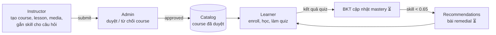
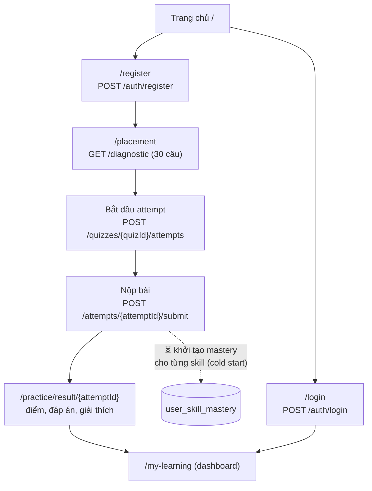
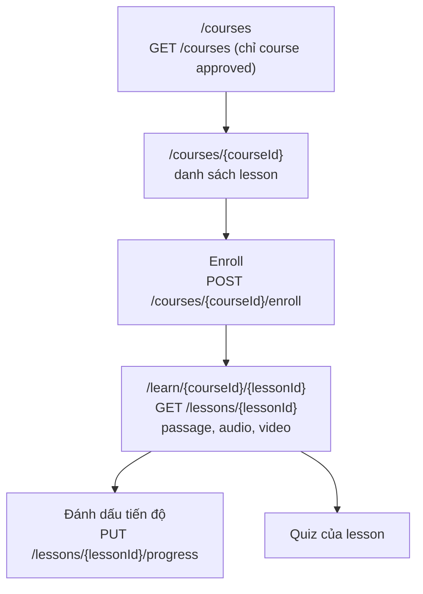
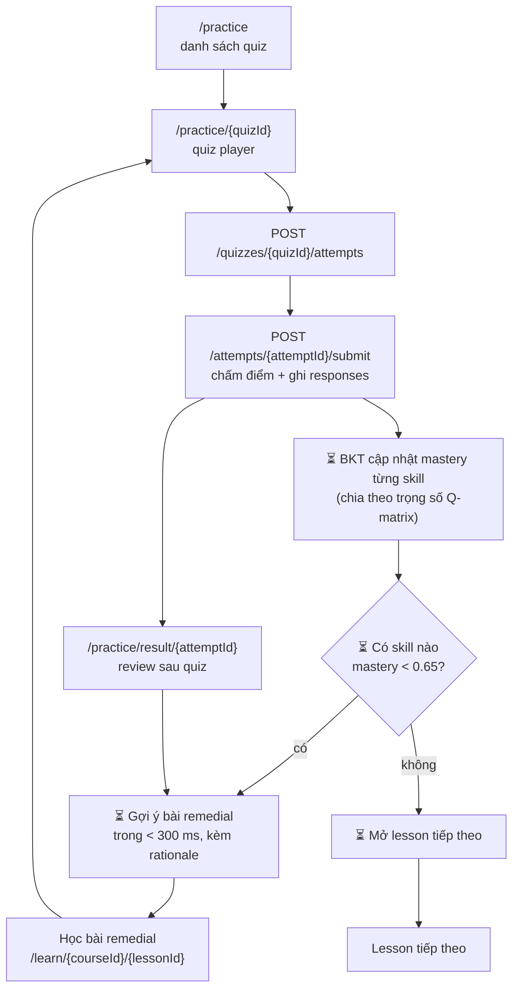
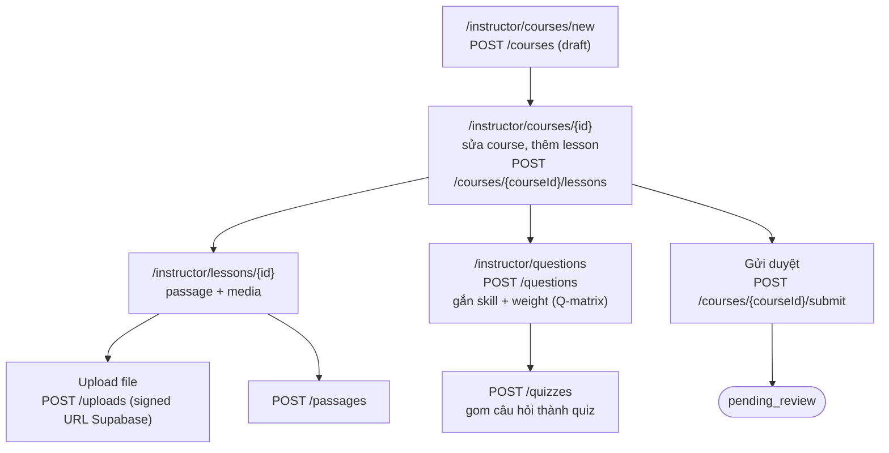
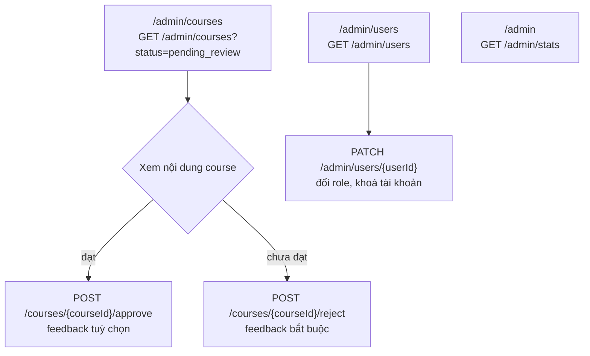
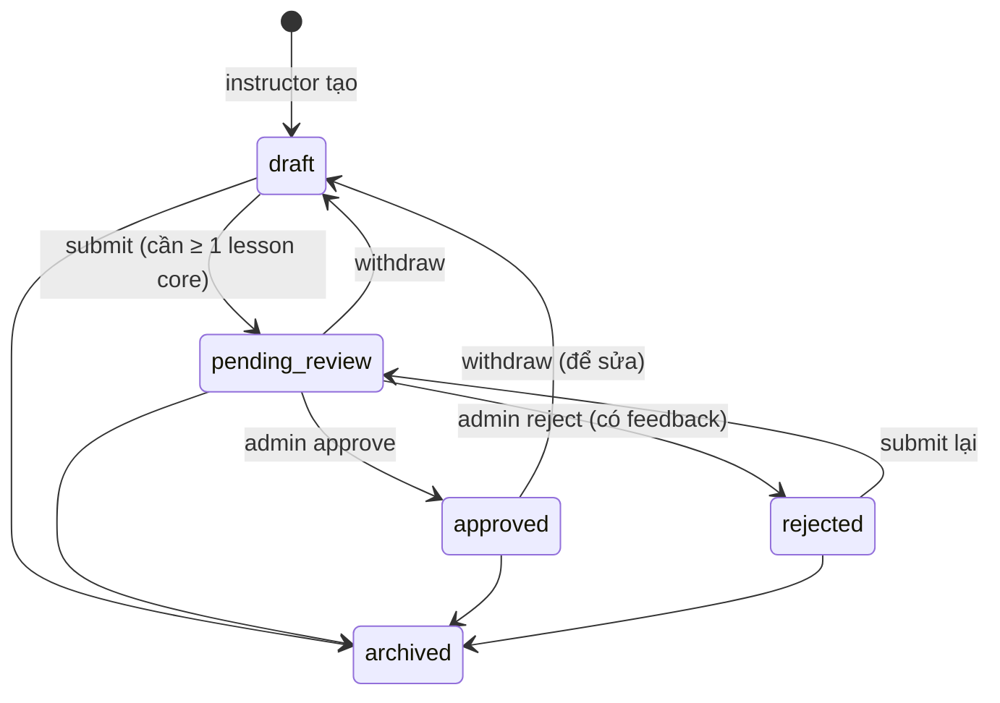

# IELTStudy — User Flow chính

Tài liệu này mô tả các luồng người dùng chính của IELTStudy cho 3 vai trò: **Learner**, **Instructor**, **Admin**.
Nguồn: `specs.md` (mục 3 và 5), `docs/ERD.md`, `docs/plans/phase-2-core-apis.md`, `backend/src/docs/openapi.yaml` và các trang trong `frontend/src/app/`.

> **Trạng thái:** các bước đánh dấu ⏳ thuộc **Phase 3 (BKT và recommender)**, chưa được cài đặt. Hiện tại frontend hiển thị "not available yet" cho mastery, recommendations và bài học bị khoá (`locked` luôn là `false`).

## 1. Tổng quan

Hành trình chính của learner theo spec (mục 5):

**Account Setup → Diagnostic Test → Initial Learning Path → Study Material → Practice Quiz → Immediate Feedback & Remediation → Next Module**

Sau khi đăng nhập, mỗi role được đưa về trang chủ riêng (`homeFor` trong `frontend/src/lib/auth-context.tsx`):

| Role | Trang chủ | Ghi chú |
| --- | --- | --- |
| Learner | `/my-learning` | Tài khoản mới đăng ký luôn là learner |
| Instructor | `/instructor` | Admin nâng quyền tại `/admin/users` |
| Admin | `/admin` | |

## 2. Learner

### 2.1 Đăng ký và bài kiểm tra đầu vào (diagnostic)

1. **Đăng ký** tại `/register` (email, mật khẩu, target band). Backend trả JWT (hạn 1 ngày, không có refresh token).
2. Sau khi đăng ký, frontend chuyển thẳng đến **`/placement`**: bài diagnostic 30 câu, phủ cả 4 kỹ năng IELTS bằng câu hỏi trắc nghiệm khách quan.
3. Câu trả lời đang làm được lưu trong `localStorage` cho đến khi nộp (backend không có autosave).
4. Khi nộp, backend chấm điểm và ghi từng `question_responses` trong một transaction.
5. ⏳ Kết quả diagnostic khởi tạo mastery ban đầu cho mỗi micro-skill (giải quyết cold-start).
6. Learner xem kết quả ở `/practice/result/{attemptId}`, rồi về dashboard.

### 2.2 Dashboard và lộ trình học

`/my-learning` là dashboard của learner:

- Các course đã enroll và tiến độ (`GET /me/enrollments`).
- ⏳ Biểu đồ radar mastery theo skill (`GET /me/mastery`, trang `/mastery`).
- ⏳ **Next best step**: bài remedial được gợi ý, kèm lý do dễ hiểu, ví dụ *"Recommended because latent mastery on 'Conditionals Type 3' is below 0.65"* (`GET /recommendations`).
- Lịch sử làm bài: `/my-learning/history` (`GET /me/attempts`).

### 2.3 Enroll và học bài

1. Duyệt catalog `/courses` (3 course mẫu: Beginner, Intermediate, Advanced). Chưa đăng nhập mà bấm Enroll thì được chuyển đến `/register`.
2. Enroll, rồi vào lesson đầu tiên.
3. **Một module là một lesson.** Course là danh sách các lesson `core` theo `order_index`. ⏳ Lesson N+1 chỉ mở khi các skill trong quiz của lesson N đạt ngưỡng (quy tắc mở khoá chốt ở Phase 3 Gate).
4. Learner đọc passage, nghe audio, xem video, và lưu tiến độ (`in_progress` → `completed`).
5. Nếu course bị instructor rút về `draft`, learner vẫn giữ enrollment nhưng không mở được lesson cho đến khi course được duyệt lại.

### 2.4 Làm quiz, phản hồi và remediation (vòng lặp thích ứng)

1. Learner mở quiz (quiz luôn thuộc một lesson, nên theo luật truy cập và khoá của lesson đó).
2. Nộp bài: backend chấm điểm và lưu kết quả từng câu (`is_correct`, `attempt_order`, `response_time_seconds`).
3. ⏳ BKT cập nhật mastery của mọi skill gắn với câu hỏi. Câu hỏi gắn nhiều skill thì cập nhật được chia theo `weight` trong Q-matrix (`question_skills`).
4. ⏳ Trang review sau quiz hiển thị mastery thay đổi (`masteryChanges`) và các gợi ý.
5. ⏳ Skill nào dưới **0.65** sẽ kích hoạt gợi ý các lesson `remedial` gắn skill đó (`lesson_skills`), xếp hạng và kèm lý do. Click vào gợi ý được ghi lại (`POST /recommendations/{id}/click`) để tính Precision@3 và MRR ở Phase 6.
6. Bài remedial nằm ngoài chuỗi lesson có khoá, chỉ đến được qua recommendation.
7. Learner học bài remedial, làm lại quiz, và vòng lặp tiếp tục cho đến khi skill đạt ngưỡng và lesson tiếp theo được mở.

> **Còn mở (Phase 3 Gate):** công thức xếp hạng, quy tắc mở khoá lesson tiếp theo, và việc learner có được mở bài remedial thuộc course chưa enroll hay không.

## 3. Instructor

1. Tạo course mới (trạng thái `draft`), chọn level.
2. Thêm lesson `core` (có thứ tự) và lesson `remedial`, gắn skill cho lesson.
3. Thêm học liệu: passage đọc, audio nghe, video. File được upload thẳng lên Supabase Storage qua signed URL.
4. Soạn câu hỏi (multiple choice, true/false/not given, gap fill, matching, error identification) và **gắn micro-skill kèm trọng số**. Đây là dữ liệu BKT dùng để đo tiến bộ.
5. Gom câu hỏi thành quiz của lesson.
6. **Gửi duyệt**: course cần ít nhất một lesson core.
7. Nếu bị từ chối, đọc feedback của admin, sửa rồi gửi lại. Course đã duyệt bị khoá: muốn sửa thì **withdraw** về `draft`, sửa, rồi gửi lại.

## 4. Admin

1. **Hàng đợi duyệt** tại `/admin/courses`: duyệt (feedback tuỳ chọn) hoặc từ chối (bắt buộc có feedback). Admin không sửa nội dung course.
2. **Quản lý người dùng** tại `/admin/users`: đổi role (ví dụ nâng learner lên instructor) và khoá tài khoản.
3. **Thống kê sử dụng** trên trang `/admin`.
4. Admin hoặc chủ course có thể **archive** course ở bất kỳ trạng thái nào. Đây là cách cho course có lịch sử học viên ngừng hoạt động.

## 5. Vòng đời course

Chỉ course `approved` xuất hiện trong catalog và cho learner enroll, học bài.
