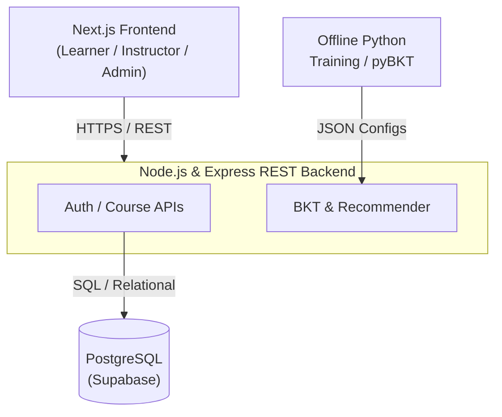

# IELTStudy – An Adaptive IELTS Learning Web Platform

## 1. Problem, Context, Target Users, and Product Value

- **Problem & Context:** Current IELTS preparation platforms predominantly rely on fixed, standardized curricula that do not account for individual learning speeds or specific skill gaps across listening, reading, writing, and speaking. As a result, IELTS candidates often spend unnecessary time reviewing familiar topics while unaddressed skill gaps persist, leading to test anxiety and stagnant band scores.
- **Target Users:** The platform is designed for IELTS candidates across all proficiency levels - from beginners building foundational language skills to advanced learners aiming for high band scores for university admission or immigration.
- **Product Value:** IELTStudy offers an adaptive IELTS learning experience featuring three structured courses: Beginner, Intermediate, and Advanced. By analyzing practice quiz logs to pinpoint specific skill gaps, the platform automatically assigns targeted review materials tailored to each student's targeted band score.

## 2. Related Solutions and Expected Differences

### Existing Solutions

- **Duolingo:** Effective for casual, gamified practice, but lacks deep academic coverage, granular diagnostic insights, and comprehensive reading or listening exercises.
- **Coursera:** Provides rigorous academic material, but relies on fixed course structures where every student follows the exact same path regardless of test results.

### Key Differentiators

- **Micro-Skill Tagging:** Course material and evaluation questions are mapped directly to specific language skills (e.g., Grammar: Inversion, Vocab: Collocations).
- **Targeted Remediation:** Instead of forcing students along a fixed sequence, weak scores on specific skills automatically trigger focused review modules and practice sets before moving forward.

## 3. Scope of Functionality, User Stories, and Acceptance Criteria

### Functional Scope & Boundary

- **In-Scope (MVP):**
  - Role-Based Access Control with Learner, Instructor, and Admin roles.
  - A comprehensive 30-question diagnostic placement test assessing all 4 IELTS skill areas via objective question formats (Reading/Listening comprehension, structured Writing error-recognition/cohesion, Speaking pronunciation/fluency logic).
  - Passage-based and audio-integrated assessment authoring.
  - Real-time latent skill tracking, post-quiz analytical remediation, and an adaptive learner dashboard.
- **Out-of-Scope:** Real-time audio streaming/WebRTC video classrooms, open-ended human grading services, and live financial gateways (simulated via mock test credits).

### Core User Stories

- **Learner:** "As a learner, I want to complete an initial placement test and receive tailored lesson suggestions after quizzes so that I can address my specific weak points."
- **Instructor:** "As an instructor, I want to upload varied learning materials and label quiz questions with target skills so the platform can measure student progress automatically."
- **Administrator:** "As an administrator, I want to review submitted course material and monitor platform usage statistics to ensure quality and maintain system security."

### Acceptance Criteria

- **Learner Flow:**
  - **Enrollment & Study:** Users register, enroll in courses, study multimedia lessons, and track completion progress on their dashboard.
  - **Adaptive Remediation:** Completing quizzes updates skill masteries in real time; any skill falling below 0.65 latent mastery triggers targeted remedial resources within < 300 ms to unlock next modules.
- **Instructor Flow:** Instructors can set up courses, upload text and video resources, tag quiz items with skill categories, and send courses for review.
- **Admin Flow:** Admins can accept or reject proposed courses with feedback, as well as manage user roles and access rights through an administrative panel.

## 4. Selected Advanced Component, Integration Method, and Evaluation Plan

- **Selected Component & Approach:** Direction 2 – Personalized Learning Paths and Recommendations. We employ a hybrid model combining Knowledge Tracing (BKT) to track skill mastery across micro-skill tags (e.g., Grammar: Inversion) and Content-Based Filtering to prescribe remedial micro-lessons whenever mastery drops below 0.65.
- **Technical Complexity:**
  - **Cold-Start Problem:** Mitigated by a mandatory 30-question placement test during onboarding to initialize the baseline skill vector.
  - **Multi-Skill Interdependence & Latency:** Decoupling questions mapping to multiple skills and re-ranking recommendations in real time (< 300 ms) without degrading UX.
- **Integration Method:** Built as an internal Node.js service module exposing REST API (`/api/v1/recommendations`). Displayed on the Learner Dashboard (next best step) and the Post-Quiz Screen with human-readable rationales (e.g., "Recommended because latent mastery on 'Conditionals Type 3' is below 0.65").
- **Evaluation Plan & Metrics:**
  - **Setup:** Simulated A/B testing on synthetic learner profiles against a static sequential curriculum and a popularity-based baseline.
  - **Metrics:**
    - Normalized Learning Gain, targeting ≥ 15% improvement:

      $$g = \frac{Score_{post} - Score_{pre}}{Score_{max} - Score_{pre}}$$

    - Precision@3 & MRR (measuring recommendation relevance and click-through).
    - Time-to-Mastery (20-30% study time reduction).

## 5. System Architecture, Data Model, Main Flow, and UI/UX Design

### Technology Stack & Architecture

- **Frontend:** Next.js, Tailwind CSS, deployed on Vercel.
- **Backend:** Node.js, Express.js REST API with JWT-based Authentication and Role-Based Access Control (RBAC), containerized via Docker.
- **Database & Asset Storage:** PostgreSQL on Supabase (with indexed JSONB fields for sequence logging); Supabase Storage for reading passages, audio prompts, and video lecture assets.
- **Offline ML Pipeline:** Parameter fitting via Python (pyBKT) calibrated on EdNet benchmark data, exporting weight configs to the Node.js runtime.

### Relational Data Model

- **Users:** (id, email, password_hash, role, target_band, created_at)
- **Courses & Lessons:** (id, instructor_id, title, target_level, status) | (id, course_id, title, order_index)
- **Passages_Media:** (id, lesson_id, type [reading_text|listening_audio], content, media_url)
- **Skills:** (id, skill_code, skill_category [Listening|Reading|Writing|Speaking], description)
- **Questions:** (id, passage_id, question_text, question_type, options, answer_key, explanation, difficulty)
- **Question_Skills (Q-Matrix):** (question_id, skill_id, weight)
- **Quiz_Attempts:** (id, user_id, quiz_id, total_score, started_at, completed_at)
- **Question_Responses:** (id, attempt_id, question_id, user_answer, is_correct, attempt_order, response_time_seconds)
- **User_Skill_Mastery:** (user_id, skill_id, mastery_prob [0.0 - 1.0], updated_at)

### Main Flow & UI/UX Principles

- **User Journey:** Account Setup → Diagnostic Test → Initial Learning Path → Study Material → Practice Quiz → Immediate Feedback & Remediation → Next Module.
- **UI/UX Design:** Simple, uncluttered reading and assessment screens; visual skill tracking using interactive radar charts; fully responsive layout optimized for desktop and mobile devices. Key screens include: Learner Dashboard; Post-Quiz Review Screen; Instructor Studio.

## 6. Implementation Plan (Weeks 39–50), Team, Dependencies, and Risks

### Timeline & Milestones

| Week | Tasks & Milestones | Assignee | Dependencies |
|------|--------------------|----------|--------------|
| 39–40 | Finalize requirements, design DB schema, create Figma UI prototypes, and set up CI/CD repository. | All members (Backend for DB, Frontend for UI, QA/DevOps for CI/CD) | None (Project Initiation) |
| 41–43 | Implement authentication, course/quiz management, and baseline recommendation prototype. | Frontend Devs (2), Backend Devs (2), ML Engineer (1) | DB Schema frozen; API Contracts (Swagger) finalized |
| 44 | **Interim Milestone:** Complete end-to-end integration and submit Interim Report. | QA/DevOps (1) leading testing, All members contributing | Core APIs and UI integration fully developed |
| 45–48 | Refine recommendation engine, execute simulated A/B testing, and perform comprehensive bug triage. | ML Engineer (1), QA/DevOps (1), Frontend & Backend Devs | Stable Quiz Logs (Question_Responses) data pipelines |
| 49–50 | Staging deployment, security hardening, finalize demo package, and submit Final Report. | QA/DevOps (1), All members | Successful bug triage and A/B test completion |

### Team Assignments (6 Members)

- **Frontend Developers (2):** UI implementation, state management, API integration, and responsive testing.
- **Backend Developers (2):** REST APIs, DB design/indexing, JWT/RBAC security, and Docker deployment.
- **Recommendation / ML Engineer (1):** Knowledge tracing model, and benchmark evaluation scripts.
- **QA & DevOps Engineer (1):** CI/CD pipeline, automated test suites, and project documentation.

### Task Dependencies & Risk Management

- **Key Dependencies:**
  - **DB Schema → Core APIs:** Backend endpoint development relies on freezing the database structure in Week 40.
  - **API Specs → Frontend:** UI integration requires early delivery of OpenAPI/Swagger definitions for mock testing.
  - **Quiz Logs → Recommendation Engine:** The recommendation algorithm requires functional data pipelines from Question_Responses before model testing.
- **Risks & Mitigations:**
  - **Integration Delays:** Reduced by defining API specifications early and using mock servers for parallel frontend-backend development.
  - **Cold-Start Bottleneck:** Mitigated by the mandatory 30-question diagnostic test providing an immediate baseline skill profile.
  - **Synthetic Data Bias:** Mitigated by calibrating synthetic simulation distributions against empirical parameters from the EdNet public educational benchmark.